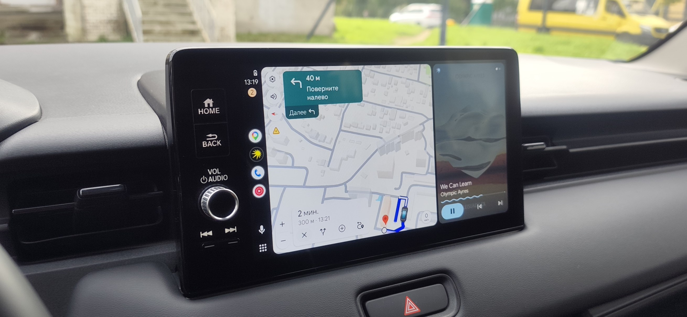

# Headswap 中文支持版

让支持 **百度 CarLife** 的车机使用手机上的 **Android Auto**，无需额外转换盒。

[本 Fork APK 下载](https://github.com/TNTfish/headswap/releases) · [上游项目](https://github.com/YegorkaPomidorka/headswap) · [上游 APK 下载](https://github.com/YegorkaPomidorka/headswap/releases) · [原版说明（俄语，含英文简介）](README.ru.md)



## 这个 Fork 提供什么

这是 [TNTfish/headswap](https://github.com/TNTfish/headswap) 的中文支持分支，基于上游 4.2.0 源码。

- 提供中文项目首页、安装步骤、常见问题和编译说明。
- 保留上游已有的简体中文界面，包括首次引导、设置、桌面、连接状态与诊断页面。
- 使自有桌面模式支持Shizuku激活
- 修复 Android 10–12 手动选择“简体中文”后，桌面未按中文模式选择应用的问题。中文模式沿用上游的国际应用方案，例如 Google 地图和 Waze，加入高德车机版。

**上游已经支持简体中文。** 如果只是想使用中文界面，可直接安装上游发布的 APK，再进入 **设置 → 语言 → 简体中文**。本 Fork 的 4.2.0 中文支持版可从[本仓库 Releases](https://github.com/TNTfish/headswap/releases)下载，包含下述语言修复。它使用独立签名，已安装上游 APK 时需要先卸载原版，卸载会清除应用设置。

## 工作原理

```text
手机上的 Android Auto ↔ Headswap ↔ USB / 兼容的无线 CarLife ↔ 原厂车机
```

Headswap 在手机上连接 Android Auto 的“车机服务器”，再把画面、音频与操作转换为车机能识别的 CarLife 协议。Android Auto 仍在手机上运行，无需在车机中安装应用。

## 使用条件

- Android 10 或更高版本的手机。
- 使用 Android Auto 模式时，需要可正常工作的 Android Auto 和 Google Play 服务。仅安装 Android Auto APK 不代表手机具备所需环境。
- 车机支持百度 CarLife。上游主要验证了 CarLife 2.0，部分其他版本有兼容记录；只有 CarPlay、J-Link 或其他互联协议的车机不能据此判断兼容。
- 首次建议使用可传输数据的 USB 线和车机的 CarLife 数据接口。无线连接取决于车机的具体实现。

应用另有“自带桌面”模式，配置流程与 Android Auto 模式不同，请按应用内引导操作。

## 安装与首次连接

1. 从[本 Fork GitHub Releases](https://github.com/TNTfish/headswap/releases)下载中文支持版 APK 并安装。若需要上游原版，请访问[上游 Releases](https://github.com/YegorkaPomidorka/headswap/releases)或[上游网站](https://yegorkapomidorka.com/headswap/)。
2. 打开 Headswap，在 **设置 → 语言 → 简体中文** 中选择中文。默认选项为“跟随系统”。
3. 按首次引导选择 **Android Auto** 模式，并授予通知、麦克风等需要的权限。
4. 打开 Android Auto 设置，滑动到底部，连续点按“版本”10 次，确认开启开发者模式。
5. 在 Android Auto 右上角的 **⋮** 菜单中选择 **启动车机服务器 / Start head unit server**。不同版本的中文名称可能略有差异。需要显示非 Google Play 来源的 Android Auto 应用时，在开发者设置中开启“未知来源”。
6. 解锁手机，用 USB 数据线连接车机的 CarLife 接口。手机询问 USB 配件的打开方式时，选择 Headswap 并按需设为默认。
7. 在车机上进入 CarLife。若未自动进入 Android Auto，先查看 Headswap 的连接状态和诊断提示。

**通话仍需要手机与车机通过蓝牙配对。** 音乐和导航提示音可通过 Headswap 传输，具体取决于车机和声音设置。

断开连接或系统关闭 Android Auto 车机服务器后，可能需要重新手动启动。Headswap 不会通过无障碍服务自动替你开启服务器。

## 常见问题

### 手机是中文，应用仍显示英文

请在 Headswap 内手动选择 **设置 → 语言 → 简体中文**。Android 13 及以上也可在系统的应用语言设置中切换。当前提供简体中文，未提供独立的繁体中文翻译。

### 车机有 CarLife，就一定能用吗

不一定。车机的 CarLife 版本、认证要求、USB 实现和视频解码能力均可能影响连接。上游已有本田、马自达、大众、丰田等多种车型的兼容记录，但同名车型不同年份或配置也可能采用不同车机。请参阅[上游兼容列表](https://yegorkapomidorka.com/headswap/)和[原版说明](README.ru.md#совместимость)。

### 能在车机直接运行高德、百度地图或任意手机应用吗

Android Auto 模式显示的是 Android Auto 支持的应用，并非完整手机投屏。应用是否能显示取决于它是否支持 Android Auto。“自带桌面”是另一种模式，需要额外配置，不能据此保证任意应用兼容。

### 已连接 CarLife，但 Android Auto 黑屏或断开

先确认 Android Auto 及 Google Play 服务可正常运行，并重新启动车机服务器；再检查数据线、USB 数据接口和 Headswap 的后台电池限制。可从应用内导出日志，提问时附上手机型号、Android 版本、车型年份、车机型号、连接方式和具体症状。

### 可以无线连接吗

上游已实现无线 CarLife，但能否使用取决于车机的蓝牙及 Wi-Fi 协议。建议先完成有线连接，再参考[上游无线说明](docs/wireless-carlife.md)和应用内引导。

### 如何更新

本 Fork 从 TNTfish/headswap 的 GitHub Releases 检查更新，与上游原版分开维护。后续 Fork 安装包需使用相同签名并递增版本，才能覆盖安装、保留设置。切换到上游或其他签名的版本时，需要先卸载现有应用，设置会被清除。

## 从源码编译

需要 Git、JDK 17 和 Android SDK。SDK 平台、构建工具及 Gradle 插件版本以 `android/` 中的配置为准；当前 `compileSdk` 和 `targetSdk` 均为 37。

```powershell
git clone https://github.com/TNTfish/headswap.git
cd headswap/android
$env:ANDROID_HOME = "C:\路径\到\Android\Sdk"
.\gradlew.bat assembleDebug
```

macOS / Linux：

```sh
git clone https://github.com/TNTfish/headswap.git
cd headswap/android
export ANDROID_HOME=/path/to/Android/Sdk
./gradlew assembleDebug
```

调试 APK 位于 `android/app/build/outputs/apk/debug/`。单元测试可通过 `gradlew.bat testDebugUnitTest`（Windows）或 `./gradlew testDebugUnitTest`（macOS / Linux）执行。

### Android Auto 车机证书

仓库不包含 Android Auto 车机证书。**缺少证书的 debug APK 即使能编译，也无法完成 Android Auto 连接。** 可按[上游说明](README.ru.md#сертификат-head-unit)准备 PEM 文件：

```text
android/app/src/main/assets/aa/jvc/cert.pem
android/app/src/main/assets/aa/jvc/key.pem
android/app/src/main/assets/aa/hur/cert.pem
android/app/src/main/assets/aa/hur/key.pem
```

上游列出的公开参考来自 [opencardev/aasdk](https://github.com/opencardev/aasdk) 和 [headunit-revived](https://github.com/andreknieriem/headunit-revived)。release 构建会检查上述两组文件，并从用户目录下的 `.android-keys/headswap-release.properties` 读取签名配置（`storeFile`、`storePassword`、`keyAlias`、`keyPassword`）；也可通过 `HEADSWAP_RELEASE_PROPERTIES` 环境变量指定该配置文件。不要将个人签名密钥或密码提交到仓库。

## 中文翻译与维护

- 英文默认资源：`android/app/src/main/res/values/strings*.xml`。
- 简体中文资源：`android/app/src/main/res/values-zh-rCN/strings*.xml`。
- 语言声明：`android/app/src/main/res/xml/locales_config.xml`。
- 语言选择与兼容逻辑：`android/app/src/main/java/com/yegorkapomidorka/headswap/AppLocale.kt`。

翻译时保持资源名称、格式占位符（如 `%1$s`、`%2$d`）以及数组项目顺序不变。上游同步后应检查是否新增文案。诊断规则中的部分建议与技术日志仍可能使用英文或俄文。

要同步上游源码，可先保存本地修改，再执行：

```sh
git remote add upstream https://github.com/YegorkaPomidorka/headswap.git
git fetch upstream
git merge upstream/main
```

如果已配置 `upstream`，跳过第一条命令；遇到冲突时应保留本 Fork 的中文文档与修复，并核对上游改动。

## 项目结构与链接

- `android/`：Android 应用，包含 Android Auto ↔ CarLife 桥接、桌面与用户界面。
- `pc-headunit/`：用于调试的 Python 车机模拟器，参见[说明](pc-headunit/README.md)。
- `docs/`：架构、协议、无线连接和设计决策，参见[架构说明](docs/ARCHITECTURE.md)。
- `tools/`：日志诊断与分析工具。
- [本 Fork 的问题反馈](https://github.com/TNTfish/headswap/issues)
- [上游项目](https://github.com/YegorkaPomidorka/headswap) · [上游网站](https://yegorkapomidorka.com/headswap/) · [上游 Telegram](https://t.me/headswap)

## 许可证与声明

遵循 [GNU GPL v3.0](LICENSE)，原项目版权归 © 2026 Yegor（yegorkapomidorka）及相应贡献者所有。`pc-headunit/proto/*.proto` 源于 headunit-revived，适用 AGPL-3.0；详见上游说明与文件声明。

本项目及中文 Fork 均非 Google、百度或汽车厂商的官方产品。Android Auto、CarLife 等商标归各自所有者所有。请停车后完成安装、配置与排查，行驶时专注驾驶。
